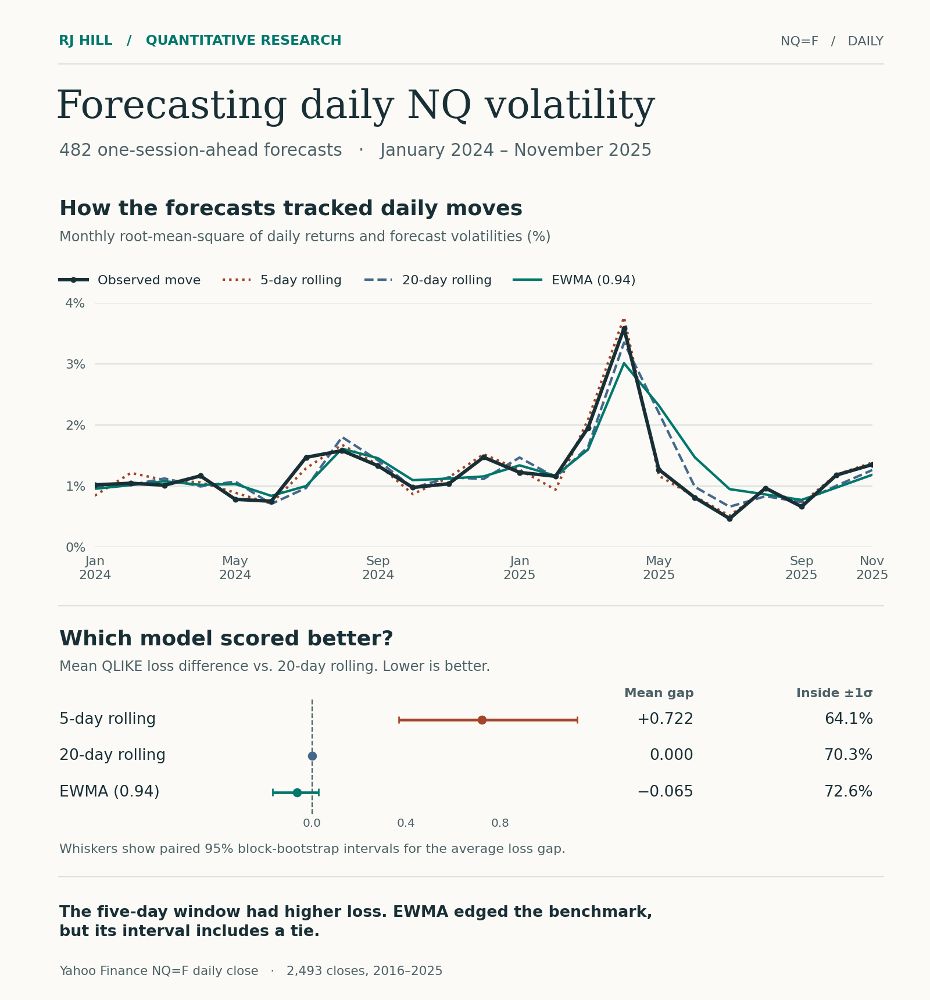

# NQ Daily Volatility Forecasting | Quantitative Research Project 001

**An out-of-sample comparison of three one-session-ahead volatility forecasts for Nasdaq-100 E-mini futures.**

[**Explore the interactive dashboard**](https://hwnw222s5n-ux.github.io/nq-volatility-forecasting/)

## Research question

How well do short-window and exponentially weighted volatility estimators track the magnitude of the next day's NQ futures price movement?

This project studies *volatility*, not the direction of returns or the precise next-day move.

## Data and evaluation

| Item | Details |
| --- | --- |
| Instrument | Yahoo Finance `NQ=F` continuous futures price series |
| Source field | Daily close |
| Source range | January 4, 2016–November 28, 2025 |
| Observed closing prices | 2,493 |
| Scored forecasts | 482 one-session-ahead forecasts, January 2024–November 2025 |
| Models | 5-day rolling, 20-day rolling, EWMA with decay 0.94 |
| Main loss function | QLIKE; lower is better |
| Uncertainty | Paired 95% block-bootstrap intervals for mean loss gaps |
| Benchmark | 20-day rolling model |

According to the embedded dashboard dataset, each forecast is labeled with the preceding available close date and the next scored session. The research should be interpreted as an evaluation of volatility estimates based on daily closes, rather than a market-trading system or executable signal.

## Results

**Full holdout sample (482 scored sessions):**

| Model | Mean QLIKE gap vs. 20-day | Paired 95% interval for gap | Inside ±1 forecast σ |
| --- | ---: | ---: | ---: |
| 5-day rolling | +0.722 | [+0.369, +1.129] | 64.1% |
| 20-day rolling | 0.000 (benchmark) | — | 70.3% |
| EWMA (0.94) | −0.065 | [−0.169, +0.028] | 72.6% |

Negative QLIKE gaps indicate lower average loss than the 20-day benchmark. The five-day estimate was worse on average; EWMA was slightly better on average, but its confidence interval crossed zero. **These results do not establish a statistically clear advantage for EWMA over the 20-day model.**

### An illustrative stress session

The dashboard allows investigation of April 9, 2025: the 20-day model's forecast based on information through April 8 was approximately **2.47%** daily volatility; the following NQ close-to-close return was approximately **+11.86%**. The comparison illustrates that a volatility estimate is not a forecast of the exact return or its direction.

## Interactive visualization

The standalone [`index.html`](index.html) contains a browser-based exploration interface and embedded forecast records. GitHub Pages hosts this file without requiring a Python server.

**[Open the live dashboard](https://hwnw222s5n-ux.github.io/nq-volatility-forecasting/)**

## Code and reproducibility status

**Dashboard available; original research scripts and reproducibility instructions pending.** The dashboard's embedded data is not a substitute for the original Python computation pipeline. The original `.py` files and any safely redistributable input/output files will be added after they are checked against the published figures.

Once uploaded, this section should specify the Python version, exact dependencies, script entry point, input data requirements, commands to reproduce the study, bootstrap configuration, and output file names. No such commands or dependency versions are claimed here yet.

## Important limitations and directions for further work

- **Continuous futures construction and rolls:** `NQ=F` is a vendor-provided continuous series. Handling of contract rolls and any adjustments should be independently verified before interpreting extreme returns.
- **Close-to-close proxy:** Squared daily close-to-close returns are an imperfect proxy for latent daily volatility. Intraday realized measures or alternate targets would provide a stronger validation benchmark.
- **Uncertainty and robustness:** Sensitivity to sample dates, event days, rolling windows, EWMA decay, and the block-bootstrap configuration should be examined.
- **Out-of-sample discipline:** Preserve the historical information cutoff at each forecast date; document any model selection decisions made after viewing the evaluation sample.
- **Not investment advice:** This is an educational research portfolio project, not a trading recommendation or performance claim.

## Data references

- [Yahoo Finance — NQ=F historical data](https://finance.yahoo.com/quote/NQ%3DF/history/)
- [CME Group — Equity index futures roll dates](https://www.cmegroup.com/trading/equity-index/rolldates.html)

## Author and feedback

Independent Python and quantitative finance research portfolio project. Constructive feedback is especially welcome on continuous futures roll handling, alternative volatility targets, the QLIKE comparison, and evaluation design.
